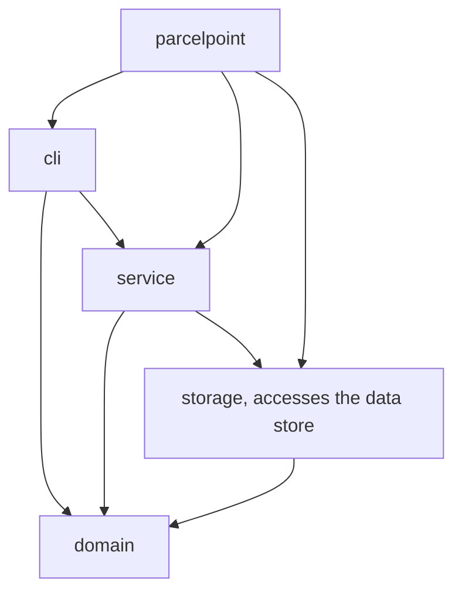
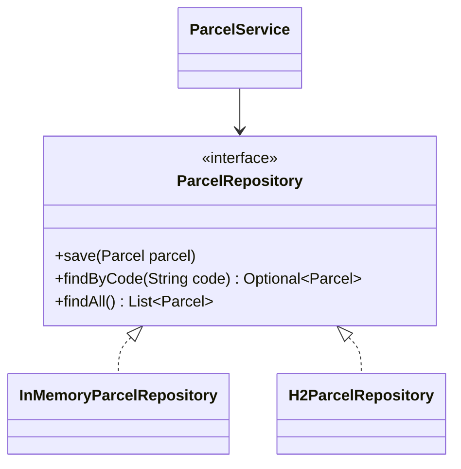
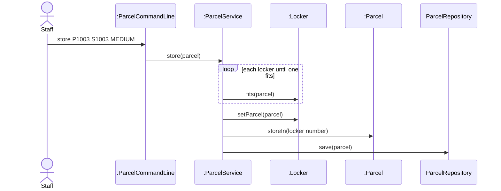

# Lab Report, Designing the Data Management Layer with H2

Repository URL: https://github.com/kafies/itcs382-h2-lab

## Tools

| Item | Version or name |
| --- | --- |
| JDK | 25|
| Maven | 3.10 |
| IDE | Intellij IDEA |
| AI tool and exact model, if you used one | Claude Haiku 5.5 |

## Part 0. From a store in memory to H2

Commit of the starter, before any change: 6eef712

0.3 Your prediction for `staff`, written before the second run: Free lockers: 1

Output of the second run, for `staff` and `quit`:

```text
ParcelPoint commands:
  store <code> <studentId> <SMALL|MEDIUM|LARGE>
  pickup <code> <days>
  find <code>
  staff
  quit
> staff
Free lockers: 3
> quit
```

State in one sentence where you think the parcels of the first run were kept.

0.5 The line of Main that you would change to keep the parcels somewhere else: 

```java
ParcelRepository repository = new InMemoryParcelRepository();
```

0.6 Commit of the switch to H2: 7d51f82

0.7 Output of `SELECT * FROM PARCEL;` after you stored two parcels:

```text
CODE  | STUDENT_ID | PARCEL_SIZE | STATUS | LOCKER_NUMBER
P1001 | S1001      | SMALL       | STORED | 1
P1002 | S1002      | LARGE       | STORED | 3
(2 rows, 18 ms)
```

0.8 Explain why ParcelPoint could not start while the H2 Shell was open, and identify the class that wrote the message `Cannot create the PARCEL table`.

```text
Because the db file parcelpoint.mnv.db is locked hence we cannot create the parcel table
```

0.9 Explain why `staff` shows no parcel while `find` shows each one, and why all three lockers look free.

```text
staff uses findAll, which is empty. find uses findByCode, which queries H2. The constructor loads nothing, so countFreeLockers counts empty lockers too so it gives 3
```

0.11 Your findAll method:

```java
@Override
    public List<Parcel> findAll() {
    String sql = "SELECT * FROM PARCEL ORDER BY CODE";
    List<Parcel> parcels = new ArrayList<>();
    try (Connection connection = connect();
         PreparedStatement statement = connection.prepareStatement(sql);
         ResultSet row = statement.executeQuery()) {
        while (row.next()) {
            parcels.add(toParcel(row));
        }
    } catch (SQLException e) {
        throw new IllegalStateException("Cannot read the parcels", e);
        }
        return parcels;
    }
```

Commit that adds findAll: 0a2372d

0.12 Output of `SELECT * FROM PARCEL;` after the pickup:

```text
CODE  | STUDENT_ID | PARCEL_SIZE | STATUS    | LOCKER_NUMBER
P1001 | S1001      | SMALL       | PICKED_UP | null
P1002 | S1002      | LARGE       | STORED    | 3
(2 rows, 16 ms)
```

0.13 Optional. Describe what `find P9999'OR'1'='1` showed while the SQL was joined from strings, and what it showed after you put the placeholder back.

## Part A. Model the design

A1 Complete the flowchart with one node for each package and one arrow for each dependency, from the package that uses to the package that is used. Mark the package that accesses the data store.



State whether cli depends on storage, and explain why.

```text
No, because when we look at the imports parcelcommandline or cli only depends on domain and service.

import parcelpoint.domain.Locker;
import parcelpoint.domain.Parcel;
import parcelpoint.domain.ParcelSize;
import parcelpoint.service.ParcelService;
```

A2 Complete the class diagram of the data management layer with ParcelService, the interface ParcelRepository with its three operations, and the two classes that implement it.



A3 Draw a sequence diagram for the command `store P1003 S1003 MEDIUM`, from the staff member to the repository. Show each message as an operation of the class that receives it.



Explain why the last lifeline is the interface ParcelRepository rather than H2ParcelRepository.

```text
ParcelService calls the interface, and the H2 class handles the call. The diagram draws the interface as the receiver because the service only knows that type
```

## Part B. Design questions

1. Identify the files that you changed to move from the store in memory to H2, and explain why no other class had to change. Use the terms of this course.

```text
6eef712 - Uploaded starter code to github
7d51f82 - Changed Main.java to use H2 Storage
0a2372d - Changed H2ParcelRepository.java to add findAll method

Main.java was only changed because only Main names a concrete repository based on Dependency Inversion Principle (DIP). The connascence between Main and the H2 class is connascence of name, since Main must spell the class name correctly.
```

2. The PARCEL table stores the size of a parcel as SMALL, MEDIUM or LARGE rather than as 1, 2 or 3. Identify the type of connascence between ParcelSize and the table in each case, and explain which one is weaker.

```text
The text values SMALL, MEDIUM and LARGE show connascence of name, both the table and ParcelSize must agree on the spelling of each name. The numbers 1, 2 and 3 show connascence of convention, both sides must agree on what each number stands for, and nothing in the names shows it. Connascence of name is weaker because renaming would only change the meaning while changing 1,2,3 can break the whole logic.
```

3. Project Phase 2 asks for a data store that needs no separate server. Explain why an embedded database such as H2 meets this rule, and describe the limit of an embedded database that Step 0.8 showed.

```text
H2 runs as a library inside the program and keeps its data in a file, so there is no separate server process to set up. The limiting factor is that if it is being run by one program, another cannot run. H2 will lock the database.
```

4. State the data store that you would choose for your Project Phase 2 team, files or an embedded database, the requirement that drives the choice, and the package that will access it.

```text
We would choose an embedded database, because the gemini project has many datatypes and a lot of information and processes. It being in a file would be hard to read and go through and would likely have many files to manage. And that data must survive restarts and multiple queries. H2 keeps the data in one file that the program creates on its first run. The storage package will access the database. 
```

## AI usage declaration

| AI tool and exact model | Date | Purpose | Files or answers it produced or changed | How you checked its output |
| --- | --- | --- | --- | --- |
| Claude Haiku 5.5 Chatbot | 08/11/2026 | Explaining the lab instructions | Step by step tutorial on how to do the lab | Cross reference the pdf file and its text output |
